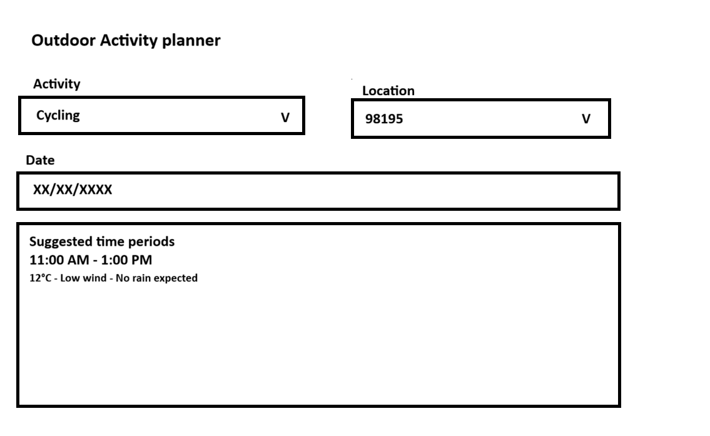
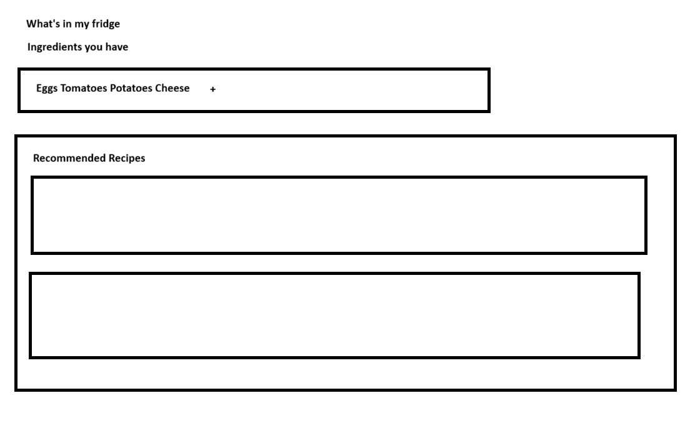
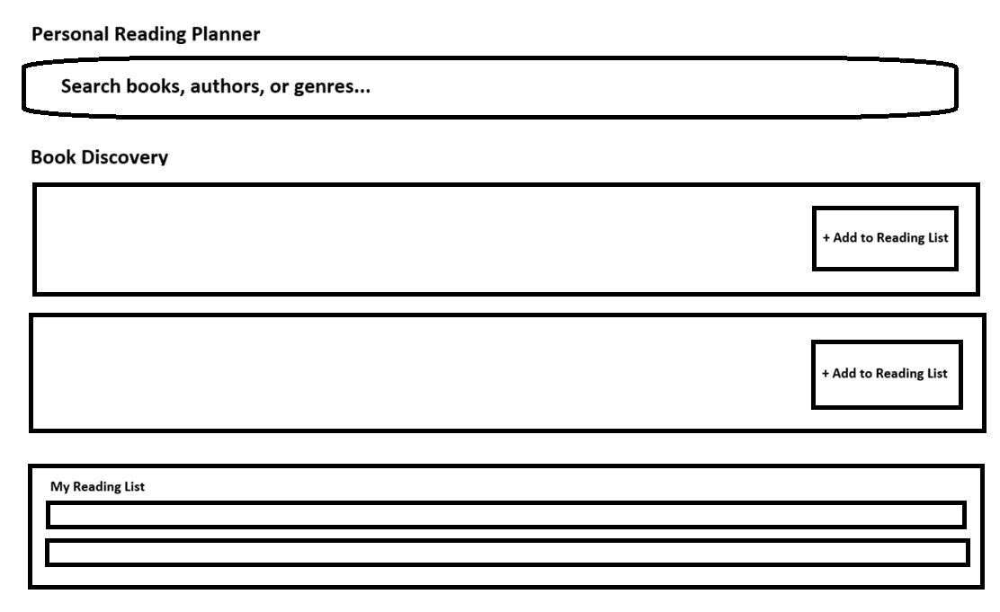

## Concept 1: UW Outdoor Activity Weather Planner

### 1. What It Is

UW Outdoor Activity Weather Planner is a web application that helps University of Washington students plan outdoor activities based on weather conditions. Users can select an activity, location, and date, and the application recommends suitable time periods by comparing temperature, precipitation, and wind conditions.

Rather than simply displaying weather forecasts, the application helps users make decisions based on their planned activities.

### 2. Target Users and Value

The target users are UW students who regularly participate in outdoor activities such as walking, cycling, running, and student club events.

Weather conditions in Seattle can change frequently, making it difficult to choose suitable times for outdoor activities. Different activities also have different weather requirements. For example, strong wind may be more important for cycling, while precipitation may be a bigger concern for an outdoor gathering.

The application combines weather information with the user's activity preferences to recommend suitable time periods. This reduces the need to manually compare multiple weather variables and helps students make more informed decisions.

### 3. Data Sources

**Open-Meteo Forecast API**

Provides hourly weather forecasts, including:

- Temperature
- Precipitation probability
- Wind speed and direction
- Weather conditions

The application uses these values to evaluate different time periods for outdoor activities.

**OpenStreetMap Data**

Provides location information about the University of Washington campus and surrounding areas. It can be used to help users select specific locations for their activities.

The application combines location information with weather forecasts to provide recommendations for selected places.

### 4. Depth Item

**Made for a Place**

This application is designed specifically for the University of Washington campus and surrounding areas. Users can choose locations such as Red Square, the Quad, or Drumheller Fountain and receive weather-based activity recommendations.

By focusing on a specific campus environment, the application provides a more relevant experience for UW students than a general weather forecast website.

### 5. Initial User Flow

1. The user opens the website.
2. The user selects an outdoor activity, such as cycling, running, or walking.
3. The user selects a campus location and date.
4. The application retrieves location information and hourly weather forecasts from the APIs.
5. Python compares the forecast data with predefined conditions for the selected activity.
6. The application displays recommended time periods and explains the weather conditions.
7. The user can save an activity plan for future reference.

### 6. User States

**Empty State**

If the user has not selected an activity, location, or date, the application asks them to complete the missing information before searching.

**Loading State**

While retrieving data from the APIs, the application displays a loading message, such as "Checking weather conditions..."

**Error State**

If the weather API is unavailable or location information cannot be retrieved, the application displays a helpful error message and allows the user to try again.

**No Suitable Results**

If no time periods meet the selected activity's conditions, the application explains that no suitable times were found and suggests checking another date or adjusting preferences.

**Success State**

The application displays recommended time periods with temperature, precipitation, and wind information. Users can review the suggestions and save their activity plans.

### 7. Key Moment Sketch

The sketch shows the main recommendation screen, where users select an activity, campus location, and date. The application displays suitable time periods along with relevant weather information and an option to save the plan.

### 8. AI Note

AI could help generate the Flask application, connect the weather and location APIs, and organize forecast information into a user-friendly interface.

However, AI may make incorrect assumptions about suitable weather conditions for different activities or overlook local campus conditions. The team would need to verify the recommendation rules and test the interface with real UW students. Final decisions about activity suitability should remain understandable and adjustable by users.

## Concept 2: What's in My Fridge? – Ingredient-Based Recipe Planner

### 1. What It Is

What's in My Fridge? is a web application that helps users discover recipes based on ingredients they already have at home.

Users enter available ingredients, and the application searches for matching recipes, compares their ingredient lists, and recommends dishes that require the fewest additional ingredients. The application can also provide information about packaged food products and allow users to save their available ingredients and favorite recipes.

### 2. Target Users and Value

The target users are college students who cook for themselves, especially those who have limited cooking experience, limited grocery budgets, or frequently have leftover ingredients.

Students may have food available in their refrigerators but not know what they can prepare with it. Looking through recipe websites can be time-consuming because most recipes require ingredients they do not have.

This application helps users make better use of their existing food, reduces unnecessary grocery shopping, and provides simple meal options without requiring users to search for individual recipes.

### 3. Data Sources

**TheMealDB API**

Provides recipe information, including:

- Recipe names and images
- Ingredients and measurements
- Cooking instructions
- Recipe categories

The application uses this information to find candidate recipes and compare their required ingredients with the user's available ingredients.

**Open Food Facts API**

Provides information about packaged food products, including:

- Product names
- Ingredient lists
- Nutritional information
- Allergen information, when available

This data can help users identify packaged ingredients and view additional food information.

### 4. Depth Item

**Many Lenses**

The application combines recipe information from TheMealDB with food product information from Open Food Facts and the user's saved ingredient list.

Instead of simply displaying recipes, it evaluates how closely each recipe matches the ingredients the user already owns and shows what additional ingredients would be needed.

This allows users to make cooking decisions based on their actual available food.

### 5. Initial User Flow

1. The user opens the website.
2. The user enters ingredients available in their refrigerator or kitchen.
3. The application saves the ingredient list.
4. The application searches TheMealDB for possible recipes.
5. Python compares each recipe's required ingredients with the user's ingredient list.
6. The application ranks recipes based on ingredient availability.
7. The user selects a recipe to view cooking instructions and missing ingredients.
8. The user can save favorite recipes or update their ingredient list.

### 6. User States

**Empty State**

If the user has not entered any ingredients, the application asks them to add at least one ingredient before searching.

**Loading State**

While retrieving recipe and food information, the application displays a message such as "Finding recipes with your ingredients..."

**Error State**

If an API request fails, the application displays a helpful error message and allows the user to retry without losing their entered ingredients.

**No Matching Recipes**

If no suitable recipes are found, the application explains that no matches are available and suggests adding more ingredients or trying different ingredient names.

**Missing Data**

If a recipe has incomplete instructions, ingredient information, or images, the application displays the available information and indicates what is missing.

**Success State**

The application displays recommended recipes with images, ingredient matches, missing ingredients, and cooking instructions. Users can select and save recipes for later use.

### 7. Key Moment Sketch

The sketch shows the main recipe recommendation screen. Users can see their available ingredients, recommended dishes, and which additional ingredients are needed.

The results prioritize recipes that match more of the user's available ingredients.

### 8. AI Note

AI could help build the Flask application, integrate the recipe and food information APIs, and implement the ingredient matching and ranking system.

However, AI may incorrectly interpret ingredient names, measurements, or substitutions. It may also generate unreliable cooking instructions or overlook food allergies. The team would need to verify the recipe information and test whether the recommendations are useful and understandable to real users.

## Concept 3: Personal Reading Discovery & Planner

### 1. What It Is

Personal Reading Discovery & Planner is a web application that helps users discover books based on their interests, find available digital editions, and organize their personal reading plans.

Users can search by title, author, or subject, explore related books, and save books to a reading list. The application also helps users identify books that are available to read online for free.

Instead of only displaying search results, the application combines book discovery with personal reading management.

### 2. Target Users and Value

The target users are college students who enjoy reading but have difficulty finding new books or keeping track of what they want to read.

Students may discover interesting books through recommendations, classes, or social media but forget about them later. They may also have difficulty finding freely available digital editions.

This application helps users discover books related to their interests, organize their reading lists, and track their reading progress. It provides a convenient place to manage reading plans rather than relying on separate book search websites and personal notes.

### 3. Data Sources

**Open Library Search API**

Provides book information, including:

- Book titles and authors
- Publication years
- Subjects and genres
- Book cover images
- Available editions and identifiers

The application uses this information to search for books and help users discover titles related to their interests.

**Gutendex API (Project Gutenberg Catalog)**

Provides information about digital books in the Project Gutenberg collection, including:

- Book titles and authors
- Languages and subjects
- Available ebook formats
- Download and reading links

The application uses Gutendex to identify potentially matching books available as free ebooks, especially older public-domain works.

### 4. Depth Item

**Acts Over Time**

The application saves each user's reading list and reading status. Users can return to their lists later, update their progress, and review previously saved books.

The application could also provide scheduled reading reminders to help users maintain their reading habits.

### 5. Initial User Flow

1. The user opens the website.
2. The user searches for a book, author, or subject.
3. The application retrieves book information from Open Library.
4. The application checks Gutendex for potentially matching free digital editions.
5. The application displays book information, available reading options, and related books.
6. The user selects a book and adds it to their reading list.
7. The user can mark books as "Want to Read," "Reading," or "Finished."
8. The application saves the reading list and progress for future visits.

### 6. User States

**Empty State**

If the user has not entered a search term, the application asks them to enter a title, author, or subject. If the reading list is empty, it encourages the user to add their first book.

**Loading State**

While retrieving information from the APIs, the application displays a message such as "Searching for books..."

**Error State**

If either API is unavailable, the application displays a helpful error message. When possible, it still shows information retrieved from the available source.

**No Results**

If no books match the search, the application explains that no results were found and suggests trying another title, author, or subject.

**Missing Data**

If a book does not have a cover image, publication date, or digital edition, the application displays the available information with appropriate placeholders.

**Success State**

The application displays matching books, their authors, publication information, and available digital reading options. Users can add books to their reading lists and update their reading status.

### 7. Key Moment Sketch

The sketch shows the book discovery and reading list interface. Users can view book recommendations, check available digital editions, and save books to their personal reading lists.

### 8. AI Note

AI could help develop the Flask application, integrate the book APIs, and create the reading list interface. It could also assist with matching book records across different data sources.

However, AI may incorrectly match books with similar titles or confuse different editions. It may also generate inaccurate book recommendations. The team would need to verify book information, test the matching system, and ensure that users receive accurate reading links.