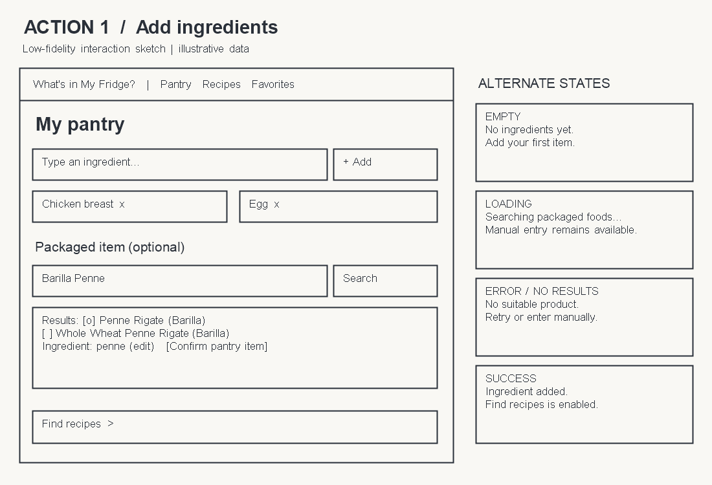
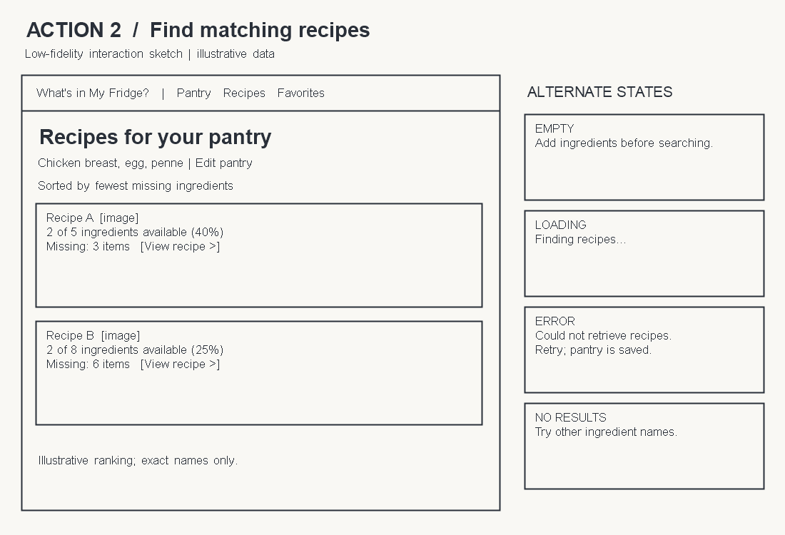
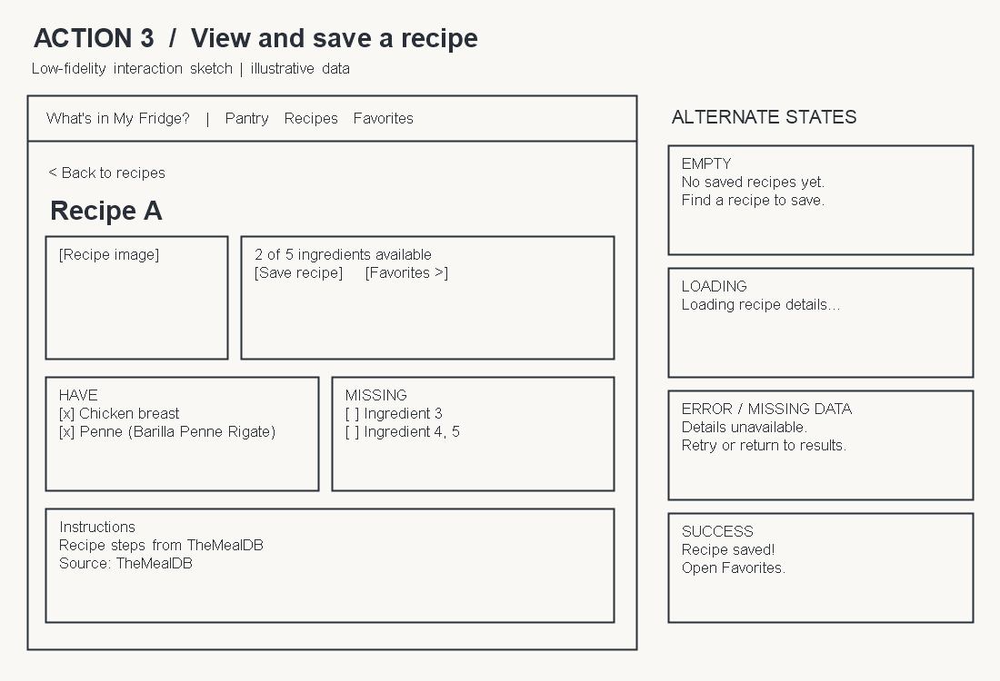

# P2 – Project Proposal

Project: What's in My Fridge? – Ingredient-Based Recipe Planner

## 1. Design Problem, Audience, and Value

College students who cook for themselves often have leftover groceries but do not know which meals they can prepare. Searching recipe websites requires them to compare long ingredient lists manually, which can be frustrating when they have limited time, money, or cooking experience. What's in My Fridge? lets students enter the food they already have and discover recipes ranked by how many additional ingredients they need. Unlike a general recipe search, it explains which ingredients are available and which are missing before a student decides what to cook.

## 2. Depth Item: Many Lenses

The app connects the student's saved pantry with recipes from TheMealDB and packaged-food details from Open Food Facts. Python compares normalized pantry ingredients with recipe requirements and presents both recipe coverage and missing ingredients; a product-name search helps the student select a packaged item and confirm its generic ingredient name; matching recipe details also identify the selected product when relevant. Together, these lenses support a specific cooking decision rather than simply displaying two independent API results.

## 3. Main User Flow

### Action 1: Add Ingredients

| The user | The app | They see |
|---|---|---|
| Opens the pantry | Loads saved pantry JSON | Existing items, or an invitation to add the first ingredient |
| Types chicken breast and egg, then clicks Add | Trims input, normalizes names, rejects blanks and duplicates, saves items | Updated ingredient chips and a confirmation |
| Optionally searches for a packaged food by name | Requests up to five product matches from Open Food Facts; lets the user select one and confirm a generic pantry ingredient name | Matching product names and brands, plus an editable ingredient name |
| Confirms an item or removes one | Updates pantry JSON | Revised pantry and enabled Find Recipes button |
| Search fails or returns no results | Keeps existing pantry intact and offers manual entry | Error or no-results message and retry option |



### Action 2: Find Matching Recipes

| The user | The app | They see |
|---|---|---|
| Clicks Find Recipes | Validates nonempty pantry; queries TheMealDB using up to three pantry ingredients | Loading message while results are fetched |
| Waits for results | Deduplicates candidate IDs, retrieves recipe details and compares required ingredients to pantry | Ranked cards with available/required counts and missing ingredients |
| Reviews recommendations | Sorts by fewest missing ingredients, then highest coverage and recipe name | Clear explanation of ranking and recipe choices |
| Gets no results or network error | Distinguishes no matches from failed retrieval; preserves pantry | Suggestion to change ingredients or retry |



### Action 3: View and Save a Recipe

| The user | The app | They see |
|---|---|---|
| Selects a recipe card | Loads details by meal ID and recalculates matches against current pantry | Recipe title, image, matched/missing ingredients, selected product names when available, measurements and instructions |
| Checks ingredients and instructions | Displays source data and marks unavailable fields | Clear checklist and source attribution |
| Clicks Save Recipe | Saves meal ID and title if not already saved | Saved confirmation and link to favorites |
| Returns to favorites | Loads saved records | Saved recipes, or an empty-state prompt; retry if details cannot load |



## 4. Data Sources

### TheMealDB

- Documentation: [TheMealDB API](https://www.themealdb.com/api.php).
- Purpose: discover candidate dishes in Action 2, then obtain ingredient quantities and instructions for Actions 2–3.
- Access: key `1` is the public educational/development key. V1 filters one ingredient per request; multi-ingredient filtering is premium. The documentation does not specify a numeric request-per-minute quota, so cap candidate lookups, cache results during a session and avoid repeated calls.
- Actual GET requests:
  - `https://www.themealdb.com/api/json/v1/1/filter.php?i=chicken_breast`
  - `https://www.themealdb.com/api/json/v1/1/lookup.php?i=53016`

Returned filter response, trimmed to one actual record:

```json
{"meals":[{"strMeal":"Belgian Waterzooi Chicken","strMealThumb":"https://www.themealdb.com/images/media/meals/nmxec11782498644.jpg","idMeal":"53466","strArea":null,"strCountry":"Belgium"}]}
```

Returned lookup response, trimmed to selected actual fields:

```json
{"meals":[{"idMeal":"53016","strMeal":"Chick-Fil-A Sandwich","strCategory":"Chicken","strIngredient1":"Chicken Breast","strMeasure1":"1","strIngredient2":"Pickle Juice","strMeasure2":"1/4 cup","strIngredient3":"Egg","strMeasure3":"1","strIngredient15":"","strMeasure15":" "}]}
```

the filter returns IDs and summary fields, not full ingredient lists. The lookup returns numbered ingredient/measurement pairs (1–20), including empty strings and blank measurements. Ignore empty ingredients, keep measurements for display, normalize names for matching, and handle null or absent data. Recipe instructions are available in `strInstructions`. Coverage is not a guarantee of sufficient quantities or dietary safety.

### Open Food Facts

- Documentation: [Open Food Facts API](https://openfoodfacts.github.io/openfoodfacts-server/api/).
- Purpose: Action 1 optionally searches packaged foods by product name. The user selects a product and confirms a generic ingredient name (for example, Penne Rigate becomes penne). The recipe detail page can then show which selected pantry products match the required ingredients.
- Access: public reads require no API key; send an identifying User-Agent. Search requests are limited to 10 per minute per IP. The official documentation notes that legacy `/cgi/search.pl` supports full-text searches, while v2 supports structured filters and v3 does not offer search. Limit results to five per explicit search, cache repeated queries during the session, and handle timeouts and HTTP 429/503.
- Actual GET request (November 22, 2026):
  - `https://world.openfoodfacts.org/cgi/search.pl?search_terms=Barilla%20Penne&search_simple=1&action=process&json=1&page_size=5&fields=product_name,brands`

Actual response, trimmed to three of five returned products:

```json
{"count":161,"page":1,"page_count":5,"page_size":5,"products":[{"brands":"Barilla, Barilla G. e R. Fratelli SpA","product_name":"Whole Wheat Penne Rigate"},{"brands":"Barilla","product_name":"Penne Rigate"},{"brands":"Barilla","product_name":"Penne Rigate Senza Glutine"}],"skip":0}
```

The search returned 161 total matches but only five products on the requested page. A search term can match several variants and brands may contain multiple labels. Show at most five product names and brands, let the user choose a result, then explicitly confirm a generic ingredient name for recipe matching. Product names may be missing or inaccurate because the database is community-maintained; manual ingredient entry remains available. This prototype does not collect nutritional or allergen data or make dietary safety claims. Attribute product data to Open Food Facts.

## 5. Data Model

| Noun | Fields | Saved? Which JSON and why? |
|---|---|---|
| Pantry item | id, user_label, normalized_name, optional product_name, optional brands | Yes, `data/pantry.json`, to retain inventory |
| Packaged product | product_name, brands | Search results cached temporarily; selected name and brands saved with the pantry item |
| Recipe | meal_id, title, image_url, category, instructions, ingredients | No, retrieve fresh details by meal ID |
| Recipe ingredient | name, normalized_name, measure | No, nested in recipe; derived from numbered fields |
| Match result | meal_id, matched, missing, coverage, matching pantry items | No, calculated from current pantry |
| Favorite | meal_id, title | Yes, `data/favorites.json`, to reopen a saved recipe |

A pantry can contain many items; an item may contain the name and brands of one selected packaged product. A recipe has many required ingredients, compared against the pantry's normalized names. A favorite references a recipe by its MealDB ID. The prototype is single-user and uses local JSON storage, not accounts.

## 6. Tech Plan

| Route | Receives | Calls | Shows |
|---|---|---|---|
| GET `/` | None | `storage.load_pantry()` | Pantry page with manual add and product search forms |
| POST `/pantry/add` | Ingredient label, optional selected product name and brands | `matching.normalize()`, `storage.add_item()` | Redirect to pantry; validation feedback |
| POST `/pantry/remove` | Item ID | `storage.remove_item()` | Updated pantry |
| POST `/product/search` | Search keyword | `api_client.search_products()` | Up to five product choices and ingredient confirmation form, or manual-entry fallback |
| GET `/recipes` | Current pantry | `api_client.find_meals()`, `api_client.get_meal()`, `matching.rank()` | Ranked results or empty/error state |
| GET `/recipes/<meal_id>` | Meal ID | `api_client.get_meal()`, `storage.load_pantry()`, `matching.compare()` | Recipe detail, matching product names when available, and save form |
| POST `/favorites/add` | Meal ID | `api_client.get_meal()`, `storage.add_favorite()` | Redirect to recipe with confirmation |
| GET `/favorites` | None | `storage.load_favorites()` | Saved recipe list |

| File | Responsibility |
|---|---|
| `app.py` | Flask routes, validation, rendering, redirects and error messages |
| `api_client.py` | HTTP requests, timeouts, field parsing and limited caching |
| `matching.py` | Normalize ingredient names, compare sets, calculate coverage, rank |
| `storage.py` | Read and write local JSON; initialize missing files and handle errors |
| `templates/base.html` | Shared navigation and layout |
| `templates/pantry.html` | Pantry and product name search |
| `templates/recipes.html` | Ranked recipe cards |
| `templates/recipe.html` | Ingredient checklist, matching packaged product names, source instructions and save control |
| `templates/favorites.html` | Saved recipes |
| `static/style.css` | Accessible visual styling and responsive layouts |
| `data/pantry.json`, `data/favorites.json` | Runtime persistent data (ignored by Git) |
| `tests/` | Matching, storage and Flask route tests using controlled fixtures |
| `requirements.txt` | Python dependencies |

## 7. Who We'll Test With

I plan to test the application with three college students who regularly cook for themselves.
1. A friend who cooks almost every day on a limited budget. I will contact him by text message to arrange a usability test.
2. A roommate who recently started cooking instead of eating out. I will ask him in person to participate in the test.
3. A roommate who frequently has leftover ingredients. I will ask him in person to test whether the application helps him find suitable recipes.
I plan to conduct the tests between November 30 and December 6, depending on participants' availability. Each participant will be asked to add ingredients, find matching recipes, and save a recipe without assistance.

## 8. Success Criteria

**Code:**

- A known pantry/recipe fixture produces exact matched and missing lists, with coverage equal to matched unique ingredients divided by required unique ingredients; zero requirements are marked unavailable, not divided by zero.
- The Many Lenses flow combines a confirmed generic ingredient label from a selected product-name search with MealDB requirements, displaying matching selected product names in recipe details and a ranking that changes when the pantry changes.
- Pantry and favorites survive a restart; empty input, null API results and simulated network failure produce understandable messages without losing data.

**Real-user testing:**

- At least 2 of 3 participants add three ingredients and reach recommendations without facilitator help within two minutes.
- At least 2 of 3 correctly explain why the top recipe is ranked first and identify one missing ingredient.
- At least 2 of 3 save and reopen a recipe and rate usefulness at least 4/5.

## 9. Priorities and Risks

Must-have: editable persistent pantry, optional packaged-food name search, recipe discovery and ranking, recipe detail with missing ingredients, favorites, and empty/loading/error states.

Nice-to-have, in order: common ingredient aliases, filters by category, improved responsive design, optional nutrition display.

| Risk | Early test and mitigation |
|---|---|
| Ingredient spelling and inconsistent API fields can produce false matches | Test capitalization, spaces, duplicates and blank API fields with known fixtures. Use conservative exact normalized matches and show limitations. |
| External services may be slow, rate-limited, or incomplete | Test a real request early, then simulated timeout/429/no-result responses. Cap calls and preserve manual entry and pantry data. |

## 10. AI Plan

We plan to use AI to provide suggestions during development and assist with writing small portions of code. We will manually review every piece of AI-generated code to ensure that we understand its purpose and how it works. We will also test the code to confirm that it runs correctly, performs its intended functions, and meets the success criteria outlined in Section 8. We will avoid asking AI to generate large or complicated functions at once, allowing us to maintain a clear understanding of the project's structure and implementation.

## 11. Pair Responsibilities

not applicable, Alex completed the P2 proposal and P1 individually
